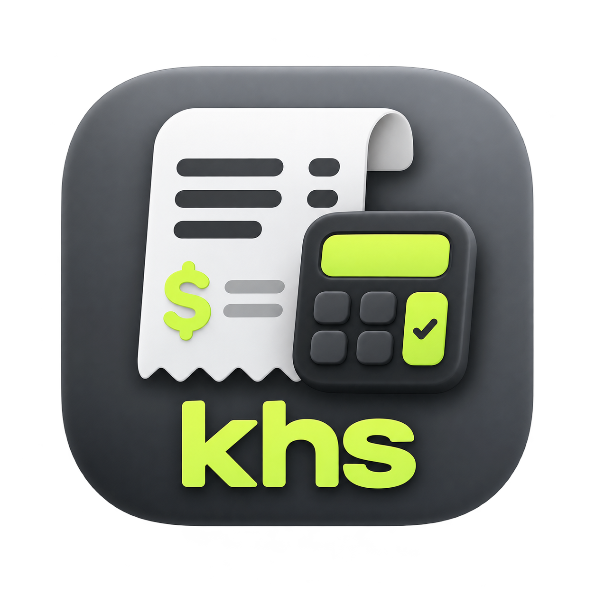
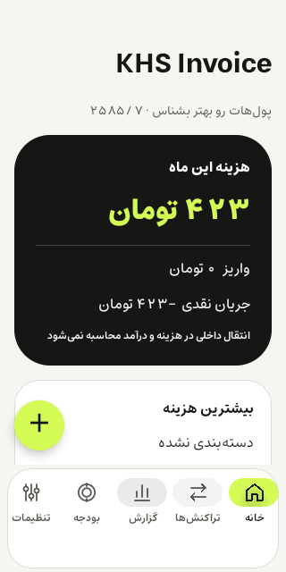
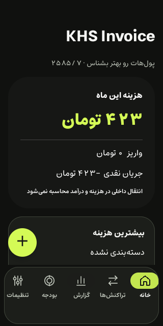
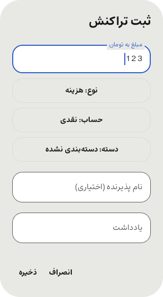

<div align="center">



# KHS Invoice

</div>

**KHS Invoice** is an offline Android app for tracking monthly spending. It reads Iranian bank SMS messages on the phone and turns them into expenses and deposits. The interface is Persian and right-to-left. The app has no internet permission: nothing you record can leave the device. Licensed under MIT.

---

<div dir="rtl">

## KHS Invoice چیست؟

برنامه Android برای حساب‌کردن خرج ماهانه. پیامک‌های بانک را روی خود گوشی می‌خواند و خرید، برداشت و واریز را خودش ثبت می‌کند؛ ثبت دستی هم بدون هیچ مجوزی کار می‌کند.

<p align="center">



</p>

## بدون اینترنت

برنامه مجوز اینترنت ندارد و هیچ کدی برای شبکه در آن نیست. این فقط یک قول نیست:

* در [AndroidManifest.xml](app/src/main/AndroidManifest.xml) مجوزهای `INTERNET` و `ACCESS_NETWORK_STATE` با `tools:node="remove"` حذف می‌شوند؛ اگر روزی کتابخانه‌ای آن‌ها را اضافه کند، ساخت برنامه دورشان می‌ریزد.
* آزمون [NoInternetTest](app/src/androidTest/java/ir/hesab/app/NoInternetTest.kt) روی برنامه نصب‌شده فهرست دقیق مجوزها را بررسی می‌کند و نشان می‌دهد سیستم‌عامل اجازه باز کردن سوکت به برنامه نمی‌دهد.
* تبلیغ، آمارگیری، حساب کاربری و سرویس ابری وجود ندارد. پشتیبان‌گیری ابری Android هم برای برنامه خاموش است.

جزئیات بیشتر در [docs/SECURITY.md](docs/SECURITY.md).

## امکانات

* **خواندن پیامک بانک:** هم پیامک جدید در لحظه، هم پیامک‌های قبلی صندوق. فقط فرستنده‌هایی که خودتان تأیید کرده‌اید خوانده می‌شوند. رمز پویا، تبلیغ و تراکنش ناموفق ثبت نمی‌شود و متن پیامک ذخیره نمی‌شود.
* **پیدا کردن خودکار بانک‌ها:** برنامه صندوق پیامک را می‌گردد و فرستنده‌های بانکی را با حدس نام بانک پیشنهاد می‌دهد.
* **دسته‌بندی:** دسته‌های جدا برای خرج و برای واریز (درآمد، دنگ، کمک، هدیه، سایر)، با امکان ساخت دسته جدید. برای خرج جدید اعلانی با سه دسته سریع می‌آید.
* **بودجه ماهانه** برای کل ماه یا هر دسته، با هشدار در ۷۰، ۹۰ و ۱۰۰ درصد.
* **گزارش:** هزینه روزانه، سهم دسته‌ها، روند ماهانه، حساب‌ها، بانک‌ها و کارت‌ها در بازه دلخواه.
* **خروجی CSV و Excel** و **پشتیبان رمزگذاری‌شده** (AES-256-GCM با گذرواژه خودتان) برای انتقال به گوشی دیگر.
* **قفل برنامه** با اثر انگشت یا قفل دستگاه، پوسته روشن و تیره، نمایش به تومان یا ریال.
* **تقویم خورشیدی:** ماه و روز همان تقویم رسمی است؛ سال به شمار شاهنشاهی نمایش داده می‌شود (۱۴۰۵ = ۲۵۸۵). هنگام تایپ تاریخ هر دو شکل سال پذیرفته می‌شود.

## نصب

فایل APK را از همین بخش Releases بردارید و نصب کنید. Android 8 یا بالاتر لازم است.
https://raw.githubusercontent.com/aminkhs/khsinvoice/refs/heads/main/khs-invoice-0.5.0-source/khs-invoice/khs-invoice-0.5.0-debug.apk

اگر مجوز پیامک داده نمی‌شود:

* Android 13 به بعد برای برنامه‌ای که با فایل APK نصب شده مجوز پیامک را قفل می‌کند. در «اطلاعات برنامه» از منوی ⋮ گزینه «اجازه به تنظیمات محدودشده» را بزنید و بعد مجوز پیامک را بدهید.
* در گوشی‌های شیائومی مجوز جدای «خواندن پیامک‌های سرویس» را هم روشن کنید؛ بدون آن صندوق خالی دیده می‌شود.
* برای ثبت پیامک جدید در پس‌زمینه، محدودیت باتری برنامه را بردارید. بعد از Force stop، Android تا باز شدن دوباره برنامه پیامکی به آن نمی‌دهد.

همین راهنما داخل برنامه در «تنظیمات ← مجوز پیامک داده نمی‌شود؟» هست.

## شروع کار

۱. مراحل آغازین را طی کنید. مجوز پیامک و اعلان اختیاری است.

۲. «پیدا کردن خودکار بانک‌ها از پیامک‌ها» را بزنید، فرستنده‌های بانک خودتان را تیک بزنید و تأیید کنید. پیامک‌های قبلی خوانده می‌شوند و برای هر بانک یک حساب ساخته می‌شود.

۳. اگر در یک بانک چند حساب دارید، هر حساب را با چهار رقم آخرش در تنظیمات اضافه کنید تا پیام‌ها جدا شوند.

۴. تراکنش‌های «دسته‌بندی نشده» را از صفحه خانه دسته‌بندی کنید. هزینه نقدی را با دکمه + ثبت کنید.

اگر پیام تراکنشی ثبت نشد، «تنظیمات ← پیامک‌های بانکی که ثبت نشده‌اند» متن آن را با علت نشان می‌دهد.

## ساخت از سورس

JDK 17 و Android SDK (platform 36 و build-tools 35.0.0) لازم است. مسیر SDK را در `local.properties` بگذارید (`sdk.dir=...`) یا متغیر `ANDROID_HOME` را تنظیم کنید. ساده‌ترین راه باز کردن پوشه در Android Studio است.

از خط فرمان، در Windows:

```powershell
.\gradlew.bat :core:test :app:testDebugUnitTest :app:assembleDebug
```

در Linux و macOS:

```sh
sh gradlew :core:test :app:testDebugUnitTest :app:assembleDebug
```

`gradlew` به `java` در PATH یا متغیر `JAVA_HOME` نیاز دارد. APK در `app/build/outputs/apk/debug/app-debug.apk` ساخته می‌شود. خودِ ساخت برای گرفتن Gradle و کتابخانه‌ها اینترنت می‌خواهد؛ برنامه ساخته‌شده نه.

اسکریپت‌های پوشه [scripts](scripts) برای Windows هستند: `setup-toolchain.ps1` نسخه JDK و Android SDK را در پوشه `.tools` همین پروژه نصب می‌کند (و مجوزهای SDK گوگل را می‌پذیرد؛ اول آن‌ها را بخوانید)، `build.ps1` می‌سازد، `verify.ps1` و `test-sms.ps1` آزمون‌های دستگاه را روی شبیه‌ساز یا گوشی متصل اجرا می‌کنند و `package.ps1` بسته سورس و APK را در `dist` می‌گذارد.

برای انتشار با کلید خودتان [docs/RELEASE.md](docs/RELEASE.md) را ببینید.

## ساختار پروژه

* `core` — کتابخانه Kotlin مستقل از Android: تشخیص پیامک بانک، پول با عدد صحیح، تقویم، CSV و XLSX، همراه آزمون‌ها.
* `app/data` — پایگاه داده Room، مخزن تراکنش‌ها، تنظیمات، خروجی و پشتیبان.
* `app/sms` — دریافت پیامک، خواندن صندوق، صف رمزگذاری‌شده، WorkManager و اعلان‌ها.
* `app/ui` — صفحه‌ها با Jetpack Compose و Material 3.
* `app/security` — رمزگذاری صف موقت و پشتیبان.
* `docs` — [امنیت](docs/SECURITY.md)، [تشخیص پیامک](docs/PARSER.md)، [نتیجه آزمون‌ها](docs/VALIDATION.md)، [انتشار](docs/RELEASE.md) و [طراحی](docs/design/ANDROID-MAPPING.md).

نام بسته `ir.hesab.app` و نام کلاس‌هایی مثل `HesabDatabase` از نام اولیه پروژه («حساب») مانده‌اند. تغییرشان نصب روی نسخه‌های قبلی و خواندن پایگاه داده موجود را خراب می‌کرد.

## قواعد مالی

* همه مبلغ‌ها به ریال و با عدد صحیح ذخیره می‌شوند؛ تومان فقط در نمایش است.
* هزینه خالص = هزینه + کارمزد − بازپرداخت خرید − برگشت تراکنش.
* انتقال بین حساب‌های خودتان هزینه یا واریز نیست. پیام «انتقال» بانک ابتدا هزینه یا واریز ثبت می‌شود و دو پیام هم‌مبلغ بین دو حساب شما پیشنهاد «انتقال داخلی» می‌گیرند.
* مانده حساب از پیامک‌ها حدس زده نمی‌شود؛ فقط مانده‌ای که دستی ثبت کنید نشان داده می‌شود.
* هر پیامک یک بار ثبت می‌شود، چه زنده رسیده باشد چه از صندوق خوانده شود.
* حذف تراکنش برگشت‌پذیر است (سطل بازیافت).

## محدودیت‌ها

* تشخیص پیامک با نمونه‌های ساختگی در قالب‌های رایج بانک‌ها آزموده شده، نه با پیامک واقعی همه بانک‌ها. ممکن است قالب بانک شما خوانده نشود یا اشتباه خوانده شود؛ عددها را با صورت‌حساب بانک مقایسه کنید و برنامه را تنها دفتر مالی خود قرار ندهید.
* پایگاه داده روی گوشی رمزگذاری نشده و به حفاظت Android از فضای خصوصی برنامه متکی است. نسخه debug قابل اشکال‌زدایی است؛ کسی که گوشی باز و فعال‌بودن USB debugging را در اختیار داشته باشد می‌تواند داده آن را بخواند.
* فایل‌های CSV و Excel رمزگذاری نمی‌شوند.
* بعضی سازندگان گوشی اجرای پس‌زمینه را محدود می‌کنند و پیامک جدید دیر یا اصلاً ثبت نمی‌شود؛ «وارد کردن تاریخچه» جاافتاده‌ها را بدون تکرار اضافه می‌کند.

## مشارکت

بیشترین کمک، قالب پیامک بانک‌هاست. اگر پیامی خوانده نشد، متنش را با عددها و نام‌های ساختگی جایگزین کنید (شکل و ترتیب خط‌ها را نگه دارید) و در یک issue بفرستید، یا خودتان طبق [docs/PARSER.md](docs/PARSER.md) آن را به آزمون‌های `core` اضافه کنید. شماره حساب، کارت، مبلغ یا مانده واقعی را هیچ‌جا نگذارید.

تغییرات هر نسخه در [CHANGELOG.md](CHANGELOG.md) است.

## مجوز

کد با مجوز [MIT](LICENSE) منتشر می‌شود.

قلم‌های Estedad و Inter با مجوز SIL Open Font License 1.1 همراه برنامه‌اند؛ متن مجوزها در [app/src/main/assets/licenses](app/src/main/assets/licenses) است. کتابخانه‌های AndroidX، Kotlin و Vico مجوز Apache 2.0 دارند.

</div>
